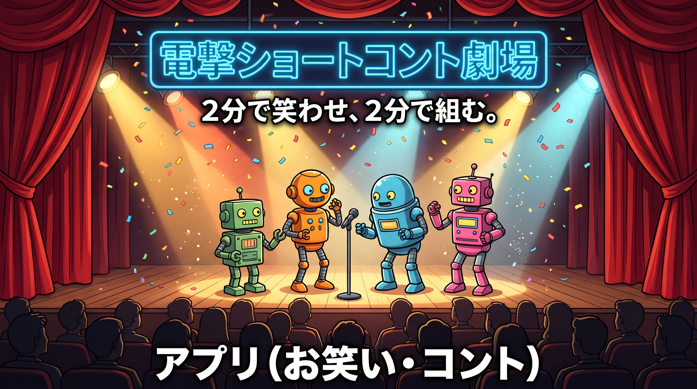

# 🎭 電撃ショートコント劇場: Code Factory Live

> **「2分で笑わせ、2分で組む。」**  
> 自律型 AI エージェント劇団が織りなす、リアルタイム・エンタープライズ開発公演。

---

### ⚡ 最新公演ハイライト (CURTAIN CALL)
- **演目名**: `showcase-excuse-craft-studio` (App編 / 全 6 幕 完走)
- **上演記録 (Forgejo)**: [公開リポジトリを観劇する](https://git.design-for-core.com/code-factory-theater/showcase-excuse-craft-studio)
- **解決 PR**: [PR #6](https://git.design-for-core.com/code-factory-theater/showcase-excuse-craft-studio/pulls/6)
- **所要時間**: `623s`
- **Green 監査スコア**: `100/100 (Clean, Mature & Verified)`
- **キャスト**:
  - 舞台監督・設営: `agent🟡`
  - 司会: `agent🔵`
  - 審査・マージ: `agent🟢`
  - 現場職人: `🍈 Melon × 🍋 Lemon`

---
*Last curtain call: 2026-11-14T14:02:50.027379Z UTC*
